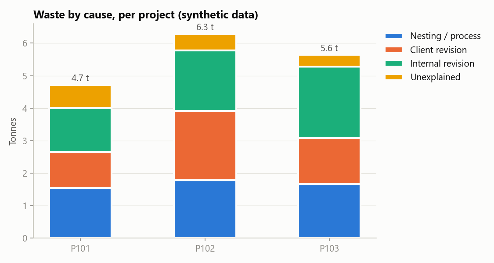
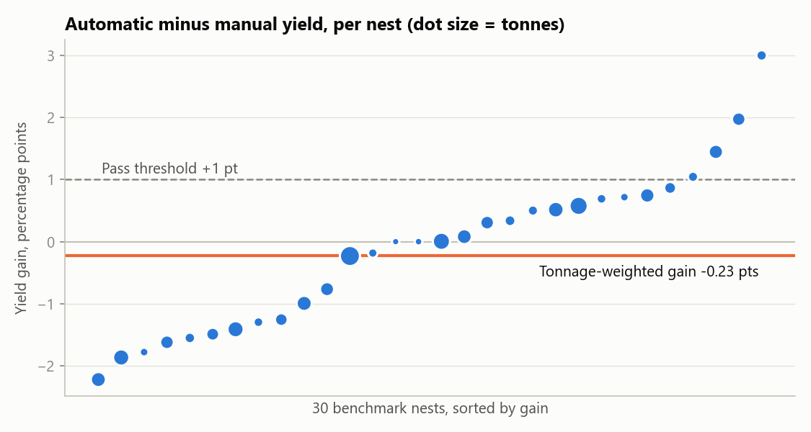
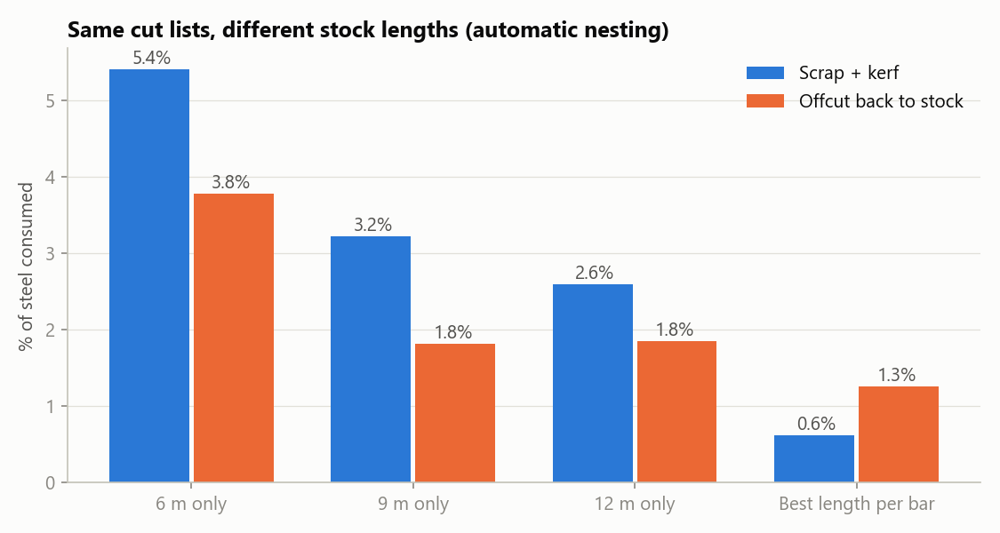
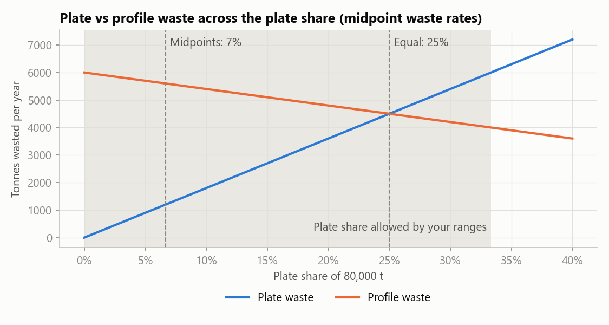

# Steel Waste Pilot: prototype results

> **Synthetic data.** Every number below comes from generated data (`steelpilot/config.py`,
> seed 42). It shows that the **method** in the case study works end to end. It says
> nothing about how much this client will save. The only section built on the client's
> own figures is section 5.

## What this prototype checks

| Claim in the case study | Section | Result |
|---|---|---|
| Ledger + cause tagging can be built from ERP-like exports | 4.3, 5.1 Test 1 | PASS: 90.5% of waste tagged, scrap within 5.6% |
| Benchmark protocol runs end to end (paired, weighted, blind, pre-set thresholds) | 5.1 Test 2, 5.2 | STOP on this data: -0.23 pts, 100.0% cuttable |
| Default optimiser settings can make automatic nesting look worse in practice | 2 (Q4), 3.1 A | default settings: +0.22 pts but only 6.7% cuttable |
| Profile waste depends on the stock length bought, before nesting | 3.1 G | scrap 2.59% on 12 m vs 0.62% with best length per bar |
| Simple offcut matching works, and its stop rule can be measured | 4.3, 5.2 | BUILD: 14.3% accepted (stop below 10.0%) |
| Plate vs profile split is uncertain within the client's ranges | 1.2 | plate share 0%–33%; equal waste at 25% |

## 1. Waste ledger and cause tagging (Test 1)

Every bar bought is followed through every cut, including later cuts of its offcuts,
and each kilogram is put into one bucket: good parts, revision scrap (client or
internal), offcuts still in stock (active or idle), short-remnant scrap, kerf, or
unexplained.

| Measure | Value |
|---|---|
| Steel bought | 154.7 t |
| Good parts | 127.2 t |
| Waste (all causes) | 16.6 t (10.8% of bought) |
| Offcuts in stock, active / idle | 1.7 t / 9.2 t |
| Yield (parts / steel consumed net of offcuts) | 88.4% |
| Waste tagged with a cause | 90.5% (pass ≥ 90.0%, stop < 80.0%) |
| Largest scrap gap vs scrap sold | 5.6% (pass ≤ 10.0%) |
| Parts cut but on no nest record | 12 parts, 1.58 t |
| Verdict | **PASS** |



Waste by cause, tonnes:

| Project | Nesting / process | Client revision | Internal revision | Unexplained |
|---|---|---|---|---|
| P101 | 1.54 | 1.10 | 1.37 | 0.70 |
| P102 | 1.78 | 2.14 | 1.85 | 0.51 |
| P103 | 1.66 | 1.42 | 2.19 | 0.37 |
| Total | 4.98 | 4.66 | 5.41 | 1.58 |

Scrap reconciliation (kerf is dust and is not sold):

| Project | Scrap sold (kg) | Ledger scrap (kg) | Difference |
|---|---|---|---|
| P101 | 3,744 | 3,967 | -5.6% |
| P102 | 5,660 | 5,731 | -1.2% |
| P103 | 5,509 | 5,230 | 5.3% |

**Finding.** The unexplained bucket is 1.58 t. Parts cut but missing from any
nest record weigh 1.58 t. The two match: the ledger finds the planted record gaps instead of hiding them, which is what Test 1 is for.

## 2. Manual vs automatic nesting (Test 2)

30 past profile nests, each re-run with the stock that existed on the nest date
(offcuts included, rebuilt from the offcut register). The gain is weighted by the
tonnes in each nest. All 90 nests went to a blind review file
(`output/blind_review.csv`, no method column); the key is in `output/blind_key.csv`.

| Method | Mean yield | Weighted gain vs manual (pts) | Judged cuttable (blind) |
|---|---|---|---|
| Manual (replay) | 96.1% | — | 100.0% |
| Automatic, default settings | 96.6% | +0.22 | 6.7% |
| Automatic, configured (clamp length set) | 96.0% | -0.23 | 100.0% |



**Verdict on this data: STOP** (gain -0.23 pts < 1.0 pts). Automatic nesting did better on
15 of 30 nests (median +0.00 pts).

**Finding.** With default settings the optimiser scores +0.22 pts on paper, but only 6.7% of its nests can be cut, because it leaves remnants too short for the saw to clamp. A nesting team that tried the automatic option with default settings would conclude "automatic wastes more". The pilot therefore configures the optimiser in week 1, before any comparison.

## 3. Stock length (Option G)

The same cut lists, nested automatically from different stock lengths:

| Stock bought | Scrap + kerf (%) | Offcut (%) | Yield (%) |
|---|---|---|---|
| 6 m only | 5.40 | 3.77 | 94.38 |
| 9 m only | 3.22 | 1.82 | 96.72 |
| 12 m only | 2.59 | 1.85 | 97.36 |
| Best length per bar | 0.62 | 1.25 | 99.37 |



**Finding.** Buying only 12 m bars gives 2.59% scrap; choosing
the length per bar gives 0.62%. Part of profile waste is decided at
purchasing, before nesting.

## 4. Offcut matching

Next drawing release: 120 parts. Same-project offcuts only, as in the pilot.

| Measure | Value |
|---|---|
| Suggestions made | 98 |
| Accepted by the (simulated) nester | 14 (14.3%) |
| Rejected, by reason | cannot locate in yard: 71, cannot clamp: 13 |
| Blocked: fit exists only on another project | 22 |
| No offcut fits | 0 |
| New steel avoided | 1.76 t (≈ $880 at $500/t) |
| Verdict (stop below 10.0%) | **BUILD** |

**Finding.** Most rejections are offcuts too old to find in the yard. The matcher's value depends on knowing where offcuts are, which links nesting to the yard problem the client raised.

## 5. Plate vs profile split (client's own ranges, not synthetic)

| Scenario | Plate waste | Profile waste | Overall | Plate share | Plate waste (t) | Profile waste (t) |
|---|---|---|---|---|---|---|
| Midpoints | 22.5% | 7.5% | 8.5% | 6.7% | 1,200 | 5,600 |
| Plate-heavy end | 20.0% | 5.0% | 10.0% | 33.3% | 5,333 | 2,667 |
| Profile-heavy end | 25.0% | 6.5% | 7.0% | 2.7% | 541 | 5,059 |



**Finding.** At the midpoints plates are 7% of tonnage and profiles waste more tonnes. Within the stated ranges the plate share can be anywhere from 0% to
33%, and plates waste more once they pass 25%. The pilot cannot be
scoped to plates only; the ledger settles the split.

The case study rounds the midpoint plate share to 7%, which gives ~1,260 t plate and
~5,580 t profile waste; the exact share (6.67%) gives the figures above.

## How to reproduce

```
cd prototype
.venv\Scripts\activate          (Windows)   |   source .venv/bin/activate   (macOS/Linux)
python run.py
python -m unittest discover -s tests
```
